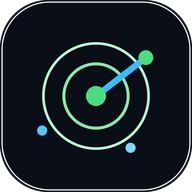
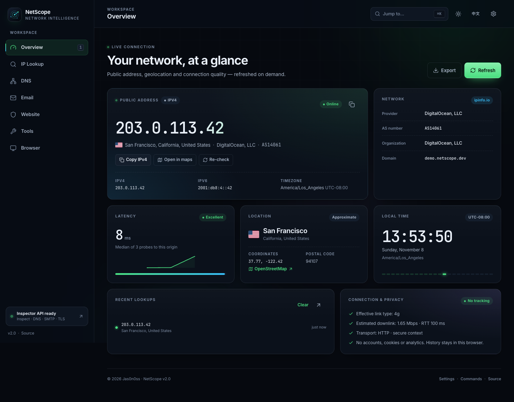

<div align="center">
  
  <h1>NetScope</h1>
  <p><strong>Modern network, email &amp; website diagnostics.</strong><br>
  Public IP, geolocation, DNS, SMTP, TLS, security headers and everyday network math — in one fast bilingual dashboard.</p>

  [Quick start](#quick-start) · [Features](#features) · [API](#api) · [Security](#security--privacy) · [Deployment](#deployment)
</div>


> **Vite rewrite:** a new React + Tailwind build of this console lives in [`web/`](web/README.md) — English/Chinese copy, dark and light themes, seven views, static Cloudflare Pages deploy. The original app below is unchanged and still runnable.



## Highlights

- **A real dashboard, not a card with an IP.** Bento layout, live local time, latency sparkline, connection quality and lookup history.
- **English & 中文.** Automatic browser-language detection, an instant language switch in Settings/drawer, localized dates, numbers and UI — technical values stay in their native form.
- **Works with zero backend.** Public IP, geolocation, DNS-over-HTTPS, dig transcripts, RDAP, subnet math, URL parsing, latency, WebRTC, email DNS and browser signals all run in the browser.
- **Adds a hardened inspector API.** Response headers, redirect chain, page metadata, TLS certificate, security-header score, plus read-only SMTP and TCP diagnostics.
- **Dark and light themes,** self-hosted variable fonts, no tracking, no cookies and no third-party analytics.
- **Accessibility built in.** WCAG AA contrast, visible focus, skip link, keyboard shortcuts, native dialogs, reduced-motion support and 44px primary controls.
- **Deployable three ways:** static hosting, one Flask/Gunicorn container, or a separate static frontend pointed at the API.

**More screens:** [dark overview](docs/screenshots/overview-dark.png) · [中文总览](docs/screenshots/overview-zh.png) · [light overview](docs/screenshots/overview-light.png) · [IP lookup](docs/screenshots/lookup-dark.png) · [DNS + dig](docs/screenshots/dns-dig.png) · [email diagnostics](docs/screenshots/email-dark.png) · [中文邮件诊断](docs/screenshots/email-zh.png) · [website inspector](docs/screenshots/website-dark.png) · [tools](docs/screenshots/tools-dark.png) · [mobile](docs/screenshots/overview-mobile.png) · [mobile email](docs/screenshots/email-mobile-zh.png)

## Features

### Overview

Public IPv4 **and** IPv6, geolocation with flag and map link, ISP/ASN ownership, median latency to the origin, connection hints (`navigator.connection`), local time in the detected timezone, recent lookups stored locally, and an exportable JSON report.

### IP &amp; domain lookup

Resolve a domain to its first A/AAAA record, then geolocate the address and pull registry data from **RDAP**: registrar, registration and expiry dates, statuses, nameservers, DNSSEC and abuse contact. IP queries return the network name, handle, address range and organization.

### DNS toolkit

Nine record types — `A`, `AAAA`, `CNAME`, `MX`, `TXT`, `NS`, `SOA`, `CAA`, `PTR` — over **DNS-over-HTTPS** with Cloudflare or Google. Automatic resolver fallback, TTL formatting, authority section, raw JSON, a **dig-style transcript**, copy/download and recent-query chips. IPv4 and IPv6 reverse lookups are built in.

### Email &amp; SMTP diagnostics

A dedicated Email view covers both sides of mail delivery:

- **SMTP server check** — banner, EHLO capabilities (`SIZE`, `PIPELINING`, `8BITMIME`, `SMTPUTF8`, `CHUNKING`…), STARTTLS / implicit TLS handshake, certificate details and advertised AUTH mechanisms. NetScope never sends credentials, addresses or messages.
- **Email DNS health** — MX, SPF, DKIM (configurable selector), DMARC, MTA-STS, TLS-RPT and BIMI, scored 0–100 with A–F grade and a combined dig transcript.
- **dig output** — every DNS result includes a Unix `dig`-style transcript with header, question, answer and authority sections.

### Network tools

- **Subnet calculator** for IPv4 and IPv6 — network, broadcast, mask, wildcard, usable range, host count, class/scope, binary mask and reverse DNS.
- **IP converter** — IPv4 ↔ decimal ↔ hex ↔ binary, IPv6 compress/expand, `/64` network and IPv4-mapped detection.
- **URL anatomy** — components, decoded query parameters, punycode/credentials/plain-HTTP warnings.
- **Latency probe** — approximate round-trip to Cloudflare, Google, GitHub and this server with a relative chart.
- **WebRTC leak check** — lists exposed ICE candidates and distinguishes public, local and mDNS addresses.
- **Port reachability** — single TCP port check through the API, public hosts only.

## Quick start

### Static mode (no backend)

The dashboard, lookup, DNS, dig, RDAP, email DNS, tools and browser views work from any static file server:

```bash
python3 -m http.server 8000
# open http://localhost:8000
```

Email DNS checks and dig transcripts also work in static mode; only the SMTP server probe needs the API.

Or serve the included static image:

```bash
docker build -f Dockerfile.static -t netscope-static .
docker run --rm -p 8080:80 netscope-static
```

Website inspection will show a “Static mode” notice until an API is configured.

### Full stack (recommended)

```bash
python3 -m venv .venv
source .venv/bin/activate          # Windows: .venv\Scripts\activate
pip install -r pyapp/requirements.txt
python pyapp/app.py                # http://localhost:8080
```

The Flask app serves the frontend and the API from the same origin, so no configuration is needed.

### Docker

```bash
docker compose up --build          # http://localhost:8080
```

or:

```bash
docker build -t netscope .
docker run --rm -p 8080:8080 netscope
```

### Separate frontend + API

If the frontend is hosted elsewhere (for example GitHub Pages), open **Settings → Inspector API**, enter the API origin, and press **Test**. NetScope stores the endpoint in `localStorage`; no rebuild is required.

Make sure the API allows that origin via `CORS_ORIGINS` and that your Content-Security-Policy permits it. The bundled Flask app sends a CSP that permits `https:` API origins and localhost.

## Configuration

| Variable | Default | Purpose |
| --- | --- | --- |
| `STATIC_DIR` | repo root / `/app` | Directory containing `index.html` and `assets/` |
| `PORT` | `8080` | Port for `python pyapp/app.py` |
| `TRUST_PROXY` | `0` | Set to `1` behind a reverse proxy to read `X-Forwarded-For` |
| `CORS_ORIGINS` | `*` | Comma-separated allowed origins for `/api/*` |
| `RATE_LIMIT_GENERAL` | `120` | Requests per minute per IP for general API endpoints |
| `RATE_LIMIT_INSPECT` | `12` | Website inspections per minute per IP |
| `RATE_LIMIT_PORT` | `12` | Port checks per minute per IP |
| `RATE_LIMIT_SMTP` | `15` | SMTP server checks per minute per IP |
| `FLASK_DEBUG` | `0` | Enable Flask debug server locally |

Gunicorn in the image binds `0.0.0.0:8080` as a non-root user and exposes a `/api/health` healthcheck.

## API

All API responses are JSON. Errors use `{ "ok": false, "error": { "code", "message", "hint" } }`.

| Method | Endpoint | Description |
| --- | --- | --- |
| `GET` | `/api/health` | Service, version and feature list |
| `GET` | `/api/ip` | Client public IP (proxies through ipify when the client is private) |
| `GET` | `/ip` | Plain-text IP, handy for `curl` |
| `GET` | `/api/inspect?url=https://example.com` | Website inspection |
| `GET` | `/api/tls?host=example.com&port=443` | TLS certificate details |
| `GET` | `/api/dns?name=example.com&type=A` | Server-side DNS lookup |
| `GET` | `/api/smtp?host=smtp.gmail.com&port=587&mode=auto` | Read-only SMTP banner, EHLO, STARTTLS/TLS and AUTH capabilities |
| `GET` | `/api/port?host=example.com&port=443` | Single TCP port reachability |
| `GET` | `/api/features` | Version and capability list |

Example:

```bash
curl "http://localhost:8080/api/inspect?url=https://example.com" | jq '.status, .meta.title, .tls.days_remaining'
curl "http://localhost:8080/api/smtp?host=smtp.gmail.com&port=587" | jq '.reachable, .capabilities.auth, .tls.days_remaining'
```

The frontend uses native ES modules and has **no build step**. Fonts are self-hosted; data is fetched directly from the public services listed in Settings.

## Localization

The UI ships in **English** and **简体中文**:

- The first visit follows the browser language (`navigator.languages`), then the choice is stored in `localStorage` as `netscope:lang`.
- Switch language with the **中文 / EN** button next to the theme toggle in the topbar, in **Settings → Language**, or via the command palette (`Switch language`).
- `Intl.DateTimeFormat`, `Intl.RelativeTimeFormat`, `Intl.NumberFormat` and `Intl.DisplayNames` localize dates, relative times, numbers and country names.
- Technical values (IP addresses, DNS records, TLS ciphers, header names, domains, dig transcripts) are deliberately left unchanged.

## Development &amp; tests

```bash
pip install -r pyapp/requirements.txt pytest
pytest -q

# JS syntax check (no bundler required)
find assets/js -name '*.js' -print0 | while IFS= read -r -d '' f; do
  cp "$f" /tmp/check.mjs && node --check /tmp/check.mjs
done
```

The API test suite (34 tests) covers static allowlisting, CORS, IP forwarding, SSRF rejection, DNS validation, SMTP capability parsing, metadata parsing, cookie redaction, rate limiting and TLS error handling.

## Deployment

The included workflow builds and pushes a multi-arch image to GHCR:

```bash
docker pull ghcr.io/jas0n0ss/webip:latest
docker run -d -p 8080:8080 ghcr.io/jas0n0ss/webip:latest
```

For GitHub Pages or any static host, publish `index.html`, `assets/`, `site.webmanifest` and `robots.txt`. The client-side features work immediately; point **Settings → Inspector API** at your deployed API for website inspection.

## Credits

- Fonts: [Inter](https://rsms.me/inter/) and [JetBrains Mono](https://www.jetbrains.com/lp/mono/) — SIL Open Font License 1.1.
- Icons: adapted from [Lucide](https://lucide.dev) — ISC License.
- Data: [ipinfo.io](https://ipinfo.io), [ipwho.is](https://ipwho.is), [ipify](https://www.ipify.org), [Cloudflare DNS](https://1.1.1.1), [Google Public DNS](https://developers.google.com/speed/public-dns), [RDAP](https://rdap.org), [flagcdn](https://flagcdn.com).
- Original project by [Jas0n0ss](https://github.com/Jas0n0ss).

---

<p align="center">Built for the open web · © Jas0n0ss · NetScope v2.0</p>
