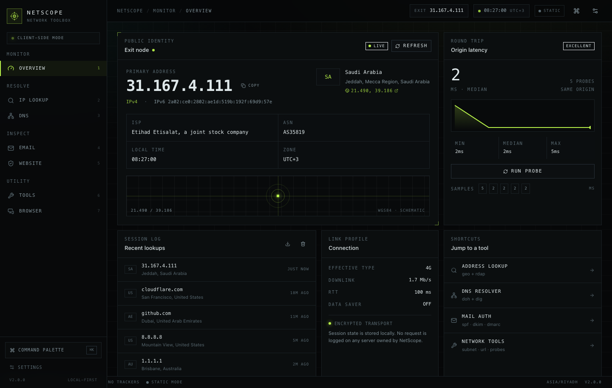
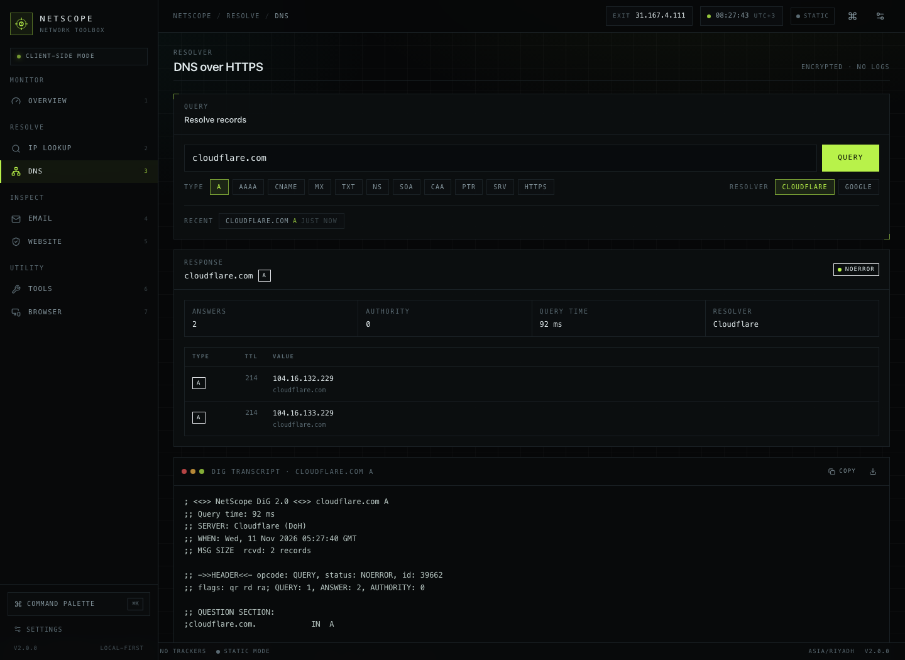
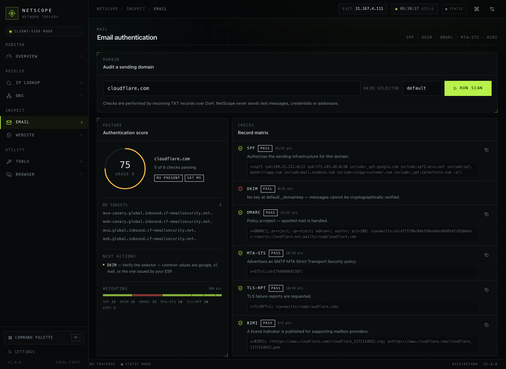
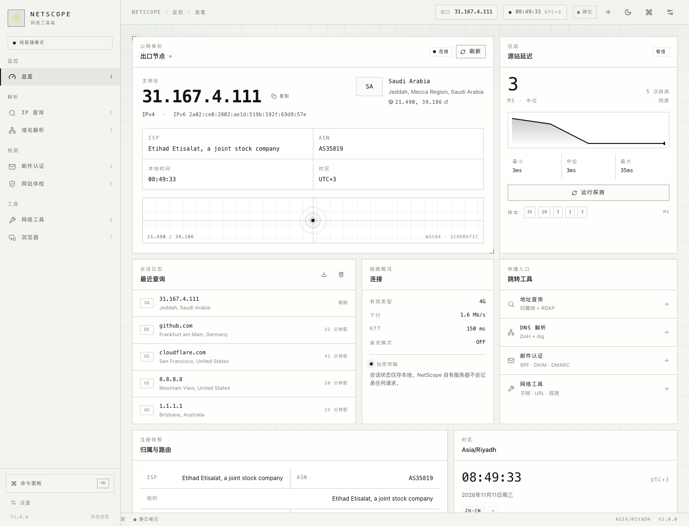
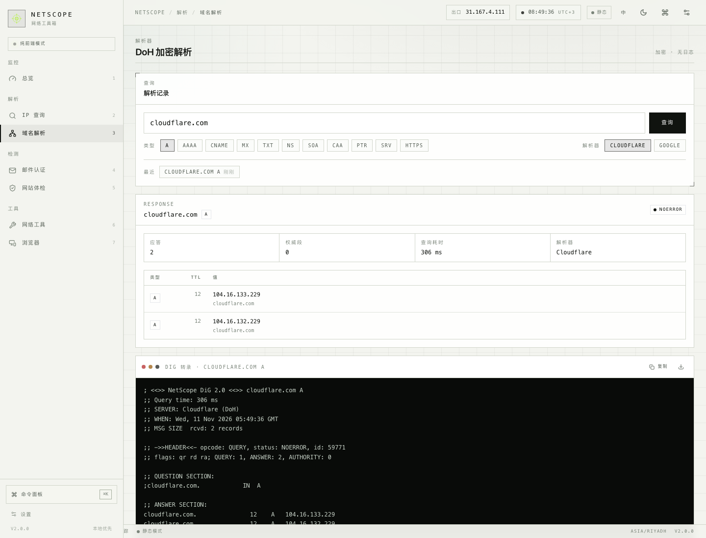

# NetScope — Network Toolbox

A single-page network diagnostic console built as a dark "instrument panel": public IP, geolocation, DoH + dig,
RDAP, email authentication, website/TLS inspection, subnet math and client signals. Static-first, no cookies,
no analytics, no server-side logging.

This is the Vite + React rewrite of the original vanilla/Flask front end. It lives in `web/` and leaves the
legacy app (`index.html`, `assets/`, `pyapp/`) untouched.



## Stack

| Layer | Choice |
| --- | --- |
| Build | Vite 6 + React 18 + TypeScript (strict) |
| Styling | Tailwind CSS 3 with a custom dark instrument theme |
| Icons | lucide-react |
| Fonts | self-hosted `@fontsource-variable` Inter + JetBrains Mono (no Google Fonts) |
| Hosting | Cloudflare Pages, static `dist/` |

Hash routing (`#/overview` … `#/browser`) keeps the build purely static, so no SSR and no rewrite rules are
needed at the edge. `public/_redirects` is included for safety if path routing is adopted later.

## Views

| # | Route | What it does |
| --- | --- | --- |
| 1 | `#/overview` | Dual-stack public IP, geolocation, origin latency sparkline, connection profile, local session log |
| 2 | `#/lookup` | Domain → A/AAAA → geolocation + RDAP registry data (registrar, status, DNSSEC, expiry) |
| 3 | `#/dns` | Eleven record types over DoH (Cloudflare → Google fallback), answer/authority tables, dig transcript |
| 4 | `#/email` | SPF / DKIM / DMARC / MTA-STS / TLS-RPT / BIMI matrix with weighted score and next actions |
| 5 | `#/website` | Header audit, redirect chain, TLS certificate and metadata — requires the inspector API |
| 6 | `#/tools` | Subnet/CIDR math, IP conversion, URL anatomy, latency probe, WebRTC ICE check, TCP port check |
| 7 | `#/browser` | UA parse, viewport/DPR, hardware, storage, WebGL/WebGPU, privacy flags, reported link |




## Languages & themes

Every view ships in English and Simplified Chinese, with a light and a dark theme — both switchable from the
top bar (`中` / `EN`, sun / moon) or from **Settings → Locale preferences**.

| Preference | Values | Storage key | Default |
| --- | --- | --- | --- |
| Language | `en` / `zh` | `netscope.v2.lang` | English |
| Theme | `system` / `dark` / `light` | `netscope.v2.theme` | `system` (follows `prefers-color-scheme`) |

- Copy is translated through a tiny store (`src/lib/i18n.ts`): the English sentence is the dictionary key, so a
  missing translation falls back to English instead of an empty string. `useT()` re-renders the whole tree on
  switch, and `document.documentElement.lang` follows (`zh-CN` / `en`). English is the default regardless of system
  language; a saved choice wins.
- Colours are CSS variables in `src/index.css` exposed through Tailwind tokens (`bg-panel`, `text-ink`,
  `border-line`…). `html[data-theme="light"]` swaps the palette: paper-white surfaces with near-black accents,
  while semantic teal / amber / danger / sky are darkened for contrast. The default `system` mode follows
  `prefers-color-scheme` live; explicit `dark` / `light` pins the choice. The theme is applied by an inline
  pre-paint script to avoid a flash, and `theme-color` stays in sync.




## Run locally

```bash
cd web
npm install
npm run dev        # http://localhost:5180
npm run build      # typecheck + production build to dist/
npm run preview    # serve dist/
```

Node 18+ recommended.

## Deploy to Cloudflare Pages

Live: **https://netscope-160.pages.dev** (Pages project `netscope`, production branch `main`).

**CLI** — Wrangler is a dev dependency, so no global install is needed:

```bash
npm run deploy     # build + wrangler pages deploy dist
```

**Dashboard** — create a Pages project from this repository:

- Root directory: `web`
- Build command: `npm run build`
- Build output: `dist`

`wrangler.toml` already pins `pages_build_output_dir = "dist"`, and `public/_headers` sets immutable caching for
hashed assets plus `no-referrer` / `nosniff` / locked-down permissions.

## Inspector API (Cloudflare Workers)

Website inspection, SMTP probing and TCP port checks run on the same origin under `/api/*`, served by Pages
Functions in [`functions/`](functions/README.md) — no separate backend or configuration needed:

| Method | Endpoint | Purpose |
| --- | --- | --- |
| `GET` | `/api/health` · `/api/features` | Service heartbeat and capability list |
| `GET` | `/api/ip` · `/ip` | Client public IP (JSON / plain text) |
| `GET` | `/api/inspect?url=` | Headers, redirect chain, metadata, certificate, header audit |
| `GET` | `/api/tls?host=&port=` | Certificate details via Certificate Transparency |
| `GET` | `/api/dns?name=&type=` | Server-side DNS over DoH |
| `GET` | `/api/smtp?host=&port=&mode=` | Banner, EHLO capabilities, STARTTLS — read-only |
| `GET` | `/api/port?host=&port=` | Single TCP port reachability |

Runtime notes: TLS comes from Certificate Transparency (Workers cannot read peer certificates, so
`version`/`cipher` are empty); outbound port 25 is blocked by Cloudflare, so SMTP probing uses 465/587/2525; the
rate limiter is per-isolate. Leave **Settings → Inspector API** empty to use this origin, or point it at an
absolute URL to use another instance. The legacy Flask app in `../pyapp` still implements the same contract for
self-hosting.

```bash
npm run dev:api     # wrangler pages dev dist — serves dist/ + the API locally
```

## Privacy model

- No cookies, no analytics, no third-party fonts or trackers.
- All lookups are client-side `fetch` calls with `credentials: 'omit'` and `referrerPolicy: 'no-referrer'`.
- History lives in `localStorage` only (`netscope.v2.*`), capped at 8 entries, clearable from Settings.
- IP geolocation degrades `ipwho.is` → `ipinfo.io` → `api.ip.sb`; DoH uses Cloudflare then Google; RDAP via
  `rdap.org`.

## Keyboard

- `1`–`7` jump between views
- `⌘K` / `Ctrl+K` command palette
- `↑` `↓` `↵` `esc` inside the palette

## Structure

```
web/
├── public/            favicon, manifest, _redirects, _headers
├── src/
│   ├── components/    shell, palette, settings, toasts, UI primitives
│   ├── lib/           typed data layer (net, dns, dig, email, tools, store, format)
│   ├── views/         seven screens
│   └── index.css      design tokens: void/panel/line/acid + panel, ticked, terminal
├── tailwind.config.js
└── wrangler.toml
```

More screens: [lookup](docs/screenshots/lookup.png) · [website](docs/screenshots/website.png) ·
[tools](docs/screenshots/tools.png) · [mobile overview](docs/screenshots/overview-mobile.png) ·
[mobile tools](docs/screenshots/tools-mobile.png)
